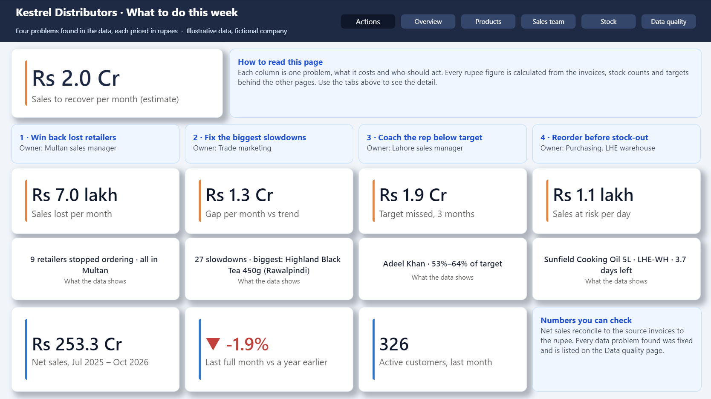
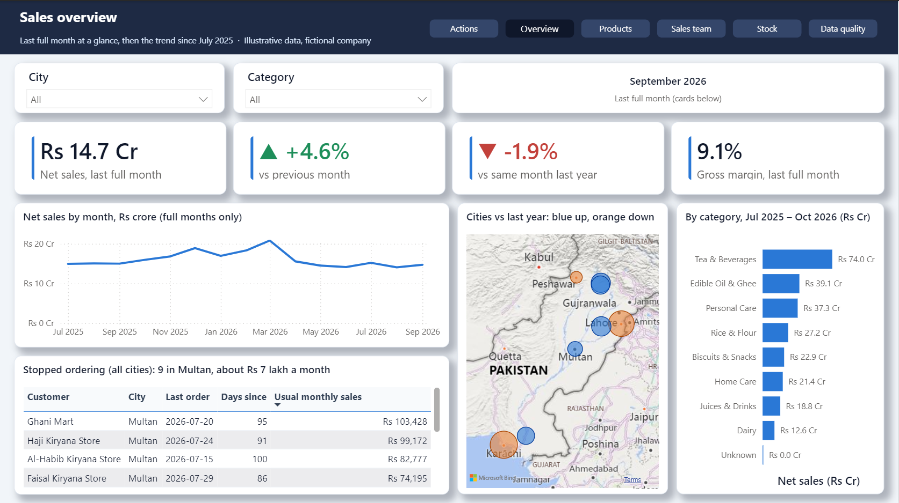
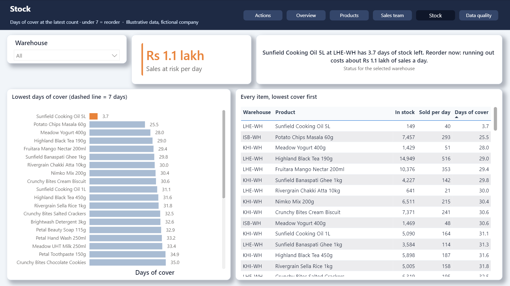

# Kestrel Distributors: end-to-end data demo

> All data is fictional: "Illustrative data — fictional company".



A mid-size distributor's data is spread across an ERP, an inventory Excel workbook and a field-sales app. This repo shows the full path:

**Python ingestion → warehouse (DuckDB locally, BigQuery in the cloud) → dbt models with tests → Power BI dashboard**

## What it found, in 30 seconds

For a business owner, the point is not the pipeline; it is what the joined data shows:

- **Two products collapsing in Karachi only:** Mango Nectar 1L fell from 5,629 units (July) to 1,816 (September); both it and Detergent 1kg run at about a quarter of the national trend.
- **One salesperson below target three months running:** SP-07 at 55%, 64% and 53%.
- **A stock-out about to happen:** cooking oil 5L at the Lahore warehouse, 149 units, about 3.7 days left.
- **Lost customers:** 9 Multan retailers have not ordered since 1 August.
- **Data problems fixed on the way:** 406 duplicate invoice lines, 80 invoices whose totals did not match their lines, 35 misspelt cities and more (full list below).

Built for mid-size distributors, manufacturers, retailers and e-commerce brands whose numbers live in an ERP, Excel files and sales apps.

## Pipeline

```
ERP CSVs ─┐                                   ┌─ seeds.city_aliases
Excel ────┼─▶ ingestion/ ─▶ raw.* (9 tables) ─┼─▶ staging.stg_* (9 views, 64 tests)
App JSON ─┘   text as handed over,            │
              + _source_file, _row_number,    ├─▶ intermediate.int_* (2 views)
              _loaded_at                      └─▶ marts.dim_* / fct_* / mart_* (13 tables)
```

| Layer | What it does |
|---|---|
| `ingestion/` | One extract function per source. It lands values **as text, unchanged** (no trimming or de-duplication), snake-cases the column names and adds metadata columns. The Excel loader skips the 3 title rows and checks the header. Full refresh into `warehouse/kestrel.duckdb`. |
| `dbt/models/staging/` | 1:1 with the sources: rename, cast and clean. Parses `DD/MM/YYYY` dates and `"12,345.00"` amounts, trims and upper-cases SKUs, restores dashes on ISB codes, maps city spellings with a seed table, removes duplicate invoice lines and visits, and converts visit times from UTC to Pakistan time. |
| `dbt/macros/` | Cleaning helpers with DuckDB and BigQuery versions, so the same models run on both. Custom tests: `row_count_equals`, `unique_combination`. |

### Data-quality issues handled in staging

Every count below matches `data/answer_key.json`.

| Issue | Rows | Where |
|---|---|---|
| City spelling variants | 35 customers | `stg_erp__customers.is_city_corrected` |
| No salesperson | 11 customers | `is_salesperson_missing` (kept) |
| SKU lower case / trailing space | 1,014 lines | `stg_erp__invoice_lines.is_sku_cleaned` |
| Exact duplicate invoice lines | 406 removed | 101,843 → 101,437; uniqueness tested |
| SKU missing from product master (KD-SNK-099) | 54 lines, 204 stock rows | warn-level tests that error if the count changes |
| Invoice header ≠ sum of lines | 80 invoices | `header_total_pkr` kept; reconciled in the intermediate layer |
| Returns as negative quantities | 231 documents | `stg_erp__invoices.is_return` |
| ISB SKU codes without dashes | 2,380 rows | `stg_inv__stock_snapshots.is_sku_cleaned` |
| Duplicate visits (sync retries) | 127 removed | 21,233 → 21,106 |
| Visit times in UTC | all | `visited_at_pkt`, `visit_date` (Asia/Karachi) |

Staging net sales come to **Rs 2,533,032,735.60**, which matches the answer key exactly.

## Marts and reconciliation

| Model | Grain | Answers |
|---|---|---|
| `dim_date`, `dim_product` (+ Unknown product), `dim_customer`, `dim_salesperson` (+ Unassigned) | one row per member | |
| `fct_sales_lines` | invoice line | all sales and returns |
| `fct_stock_weekly` | warehouse × SKU × week | closing stock, units sold, units received |
| `fct_visits`, `fct_targets_monthly` | visit; salesperson × month | |
| `mart_product_city_trend` | product × city | "Which products are slowing down in Karachi this month?" |
| `mart_salesperson_attainment` | salesperson × month | "Who has been below 85% of target three months running?" |
| `mart_stock_cover` | warehouse × SKU (latest snapshot) | "Which items are about to run out?" |
| `mart_customer_activity` | customer | "Which customers stopped ordering?" |
| `mart_data_quality` | issue | the Data quality dashboard page |

**Business rules** live in `dbt/dbt_project.yml` vars, not in SQL: slowing = seasonality-adjusted index below 0.7; low stock = under 7 days of cover (28-day average sales); at risk = no order for 30+ days; churned = 75+ days. "This month" = month to date up to the latest invoice; the baseline is the 3 full months before it. The current month's target is pro-rated and it is left out of the three-months-running flag.

**Reconciliation and signal tests** (`dbt/tests/`):
- total net sales equal the answer key, Rs 2,533,032,735.60, within Rs 1
- net sales by month equal the answer key for all 16 months (`seeds/answer_key_monthly_net_sales.csv`)
- invoice headers vs lines: exactly 80 mismatches (warns; errors if that changes)
- no negative closing stock
- planted signals: Karachi slowdown = Mango Nectar 1L and Detergent 1kg; SP-07 is the only salesperson below 85% three months running; KD-OIL-002 at LHE-WH is the only low-stock item (≈3.7 days); exactly 9 Multan customers churned

**Expected `dbt build` result:** everything passes apart from 4 documented warnings (KD-SNK-099 in staging lines and stock, the same 54 lines in `fct_sales_lines`, and the 80 header mismatches).

**Honest limits:** the rules above are reasonable defaults set for this fictional data, not universal truths; a client would agree their own. Several salespeople dip below 85% in single months; only SP-07 has a three-month run.

CI: `.github/workflows/ci.yml` regenerates the data and runs `python run.py all` on every push.

## Run

```bash
python -m venv .venv
source .venv/bin/activate          # Windows: .venv\Scripts\activate
pip install -r requirements.txt    # Python 3.11 or 3.12

python run.py all                  # load raw tables, then dbt build
```

Each step on its own: `python run.py load | dbt | test | data | clean`. If you have `make`, `make all` does the same thing. No accounts or cloud services are needed. The warehouse is a local file, `warehouse/kestrel.duckdb`.


To look around: `duckdb warehouse/kestrel.duckdb`, then `select * from staging.stg_erp__invoice_lines limit 10;`. Any DuckDB client (DBeaver, for example) also works.

## Repo map

| Path | What |
|---|---|
| `scripts/generate_sample_data.py` | Seeded generator for the 3 source systems |
| `data/raw/`, `data/answer_key.json`, `data/README.md` | Sample exports, expected answers, data dictionary |
| `ingestion/` | Loaders (`python -m ingestion.load_all --help`) |
| `dbt/` | dbt project: seeds, staging models, macros, tests |
| `run.py`, `Makefile` | Pipeline runner |
| `powerbi/` | Power BI project (`.pbip`) and report (`.pbix`) |
| `docs/` | BigQuery and Power BI guides, dashboard screenshots |

## Dashboard (Power BI)

Six pages: Actions, Overview, Products, Sales team, Stock and Data quality. The Actions page prices each problem the data reveals (lost customers, product slowdowns, a rep below target, a stock-out) and names who should act. Every figure is calculated from the marts and ties back to the answer key.

How to open and regenerate it: [docs/POWERBI.md](docs/POWERBI.md).

| Overview | Sales team |
|---|---|
|  |  |
| **Stock** | **Data quality** |
|  |  |

## Publish to BigQuery

`python run.py publish` copies the raw tables to BigQuery and runs the same dbt models and tests there. Setup: [docs/BIGQUERY.md](docs/BIGQUERY.md).

## Taking this to production

This demo runs as a full refresh on a laptop. For a client, the same design gets:

- **Scheduling and alerts:** a scheduled run (GitHub Actions, Cloud Composer/Airflow or dbt Cloud) with failure alerts.
- **Incremental loads** for large fact tables instead of full refreshes.
- **Source freshness checks** so a missing export is caught before anyone reads a stale report.
- **Security:** credentials in a secret manager, least-privilege service accounts, and data kept in the client's own cloud project.
- **Agreed definitions:** the business rules above (slowing, low stock, churn) set with the client, not assumed.

## About

Built by **Stickitownit**, an independent data & AI engineering studio (SQL, Python, dbt, BigQuery, Power BI). This repo is a portfolio demo on fictional data: it shows the method used for real client work, where the same steps run on a company's own systems.

Want the same for your business? Email: stickitownit@gmail.com

